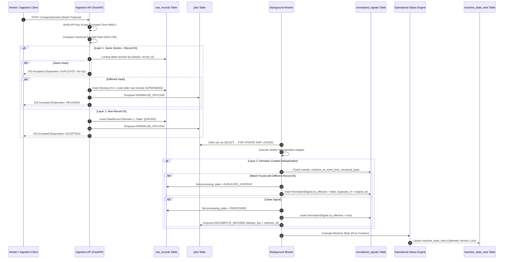
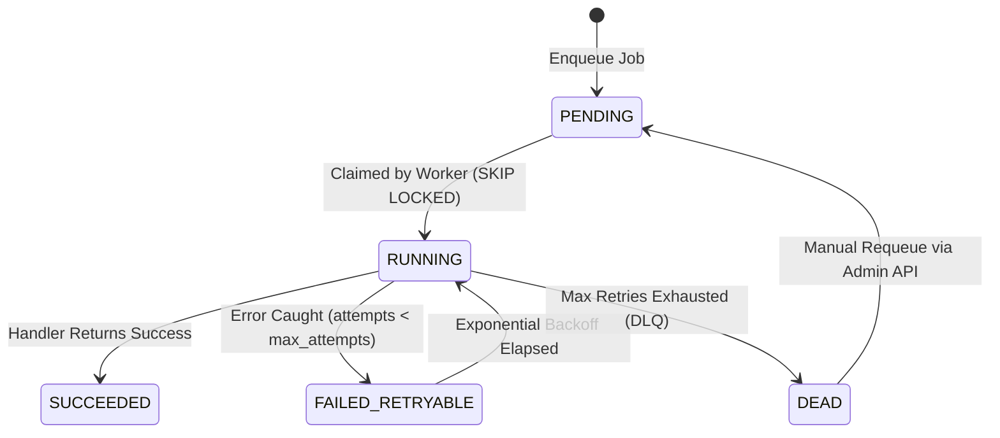
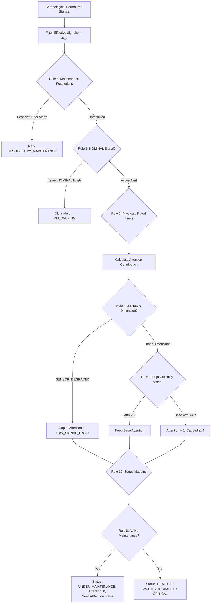
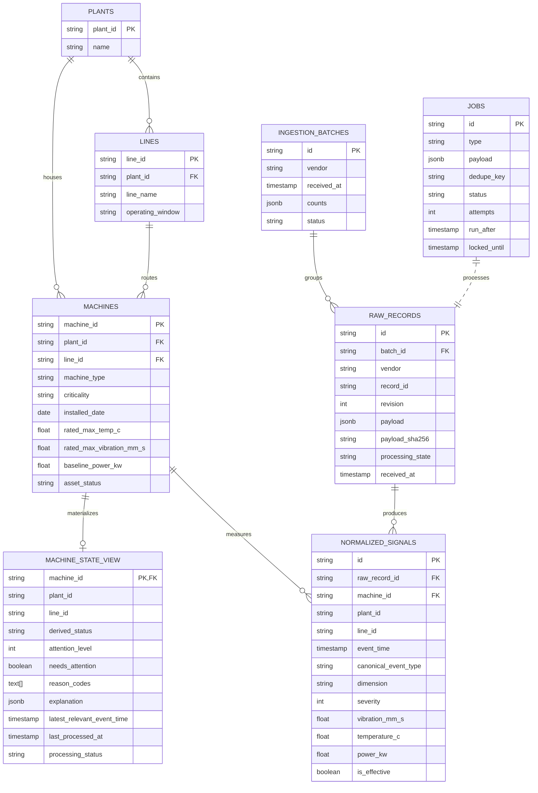

# System Architecture & Technical Specifications

The Aurik Industrial Equipment Monitoring system ingests inconsistent, multi-vendor operational and maintenance telemetry, applies two-layer idempotency, normalizes dialect differences into canonical signals, processes state transitions asynchronously via a PostgreSQL-backed job queue, and serves a deterministic, explainable operational attention view.

---

## 1. High-Level Architecture Overview

```mermaid
graph TD
    subgraph External Vendors
        PF[PulseForge Agent]
        TW[ThermexWatch Hub]
        MF[MaintaFlow API]
        WO[CMMS Work Orders]
    end

    subgraph Ingestion Layer (FastAPI)
        Auth[Role-Based Auth / Scopes]
        EnvVal[Envelope Structural Validator]
        RawStore[(raw_records)]
        L1Dedup{Layer 1 Hash Check}
        BatchStore[(ingestion_batches)]
    end

    subgraph Asynchronous Queue
        Jobs[(jobs Table)]
        Worker[Background Worker Process]
    end

    subgraph Processing & Normalization
        Adapters[Vendor Adapters]
        L2Dedup{Layer 2 Content Check}
        SigStore[(normalized_signals)]
        Engine[Deterministic Status Engine]
        StateView[(machine_state_view)]
    end

    subgraph Serving Layer
        ReadAPI[Operational Read API]
        Prom[Prometheus Metrics]
    end

    PF -->|HTTP POST| Auth
    TW -->|HTTP POST| Auth
    MF -->|HTTP POST| Auth
    WO -->|HTTP POST| Auth

    Auth --> EnvVal
    EnvVal --> L1Dedup
    L1Dedup -->|New Record| RawStore
    L1Dedup -->|Revision| RawStore
    L1Dedup -->|Duplicate| BatchStore
    RawStore --> Jobs

    Worker -->|SELECT ... FOR UPDATE SKIP LOCKED| Jobs
    Jobs --> Adapters
    Adapters --> L2Dedup
    L2Dedup --> SigStore
    SigStore --> Engine
    Engine --> StateView

    StateView --> ReadAPI
    Jobs --> Prom
```

---

## 2. Ingestion & Two-Layer Idempotency Sequence



---

## 3. Asynchronous Job State Machine

The queue is implemented on PostgreSQL without external brokers (Redis/RabbitMQ/Kafka) using transactional row locking:



- **Lease Timeout & Crash Recovery**: Every claimed job receives a `locked_until` timestamp. If a worker pod crashes mid-execution, the lease expires and another worker automatically re-claims the job.
- **Pending Deduplication**: Recompute jobs use `dedupe_key = machine_id` with a partial index `WHERE status = 'PENDING'`. High ingestion bursts collapse into a single pending recomputation per machine.

---

## 4. Pure Deterministic Status Engine



---

## 5. Relational Schema & Entity Relationships


